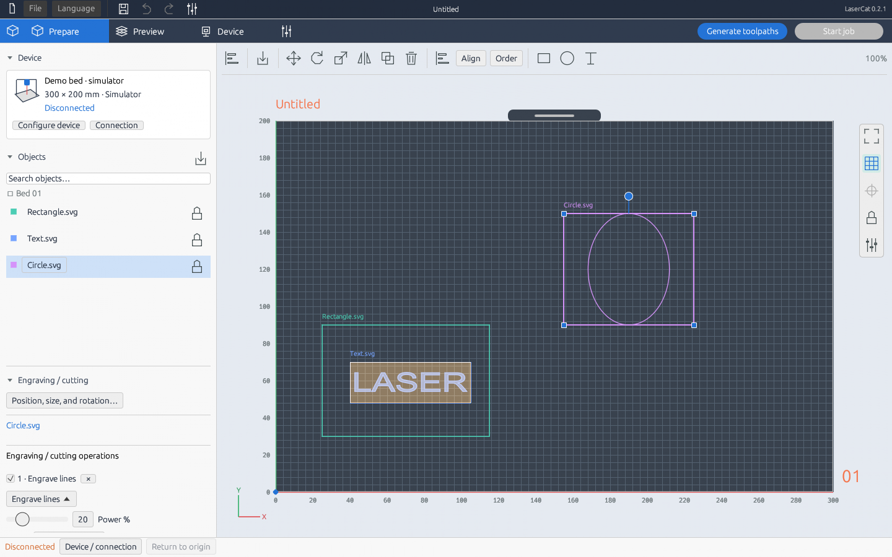
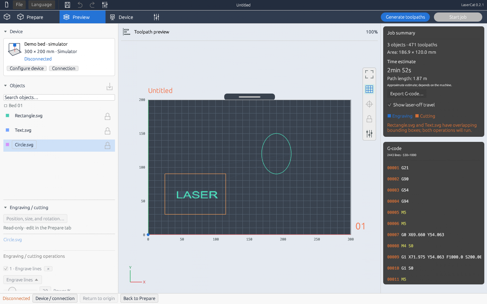
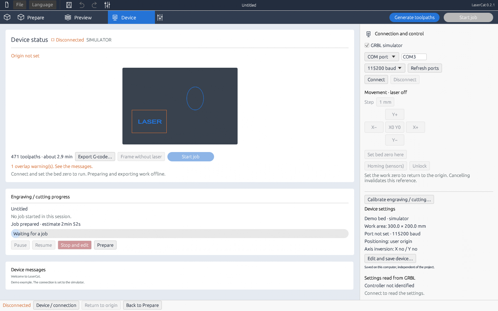
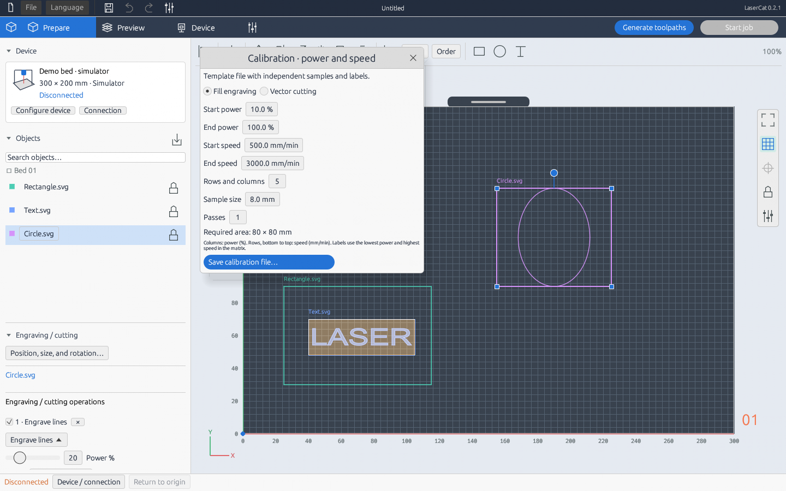
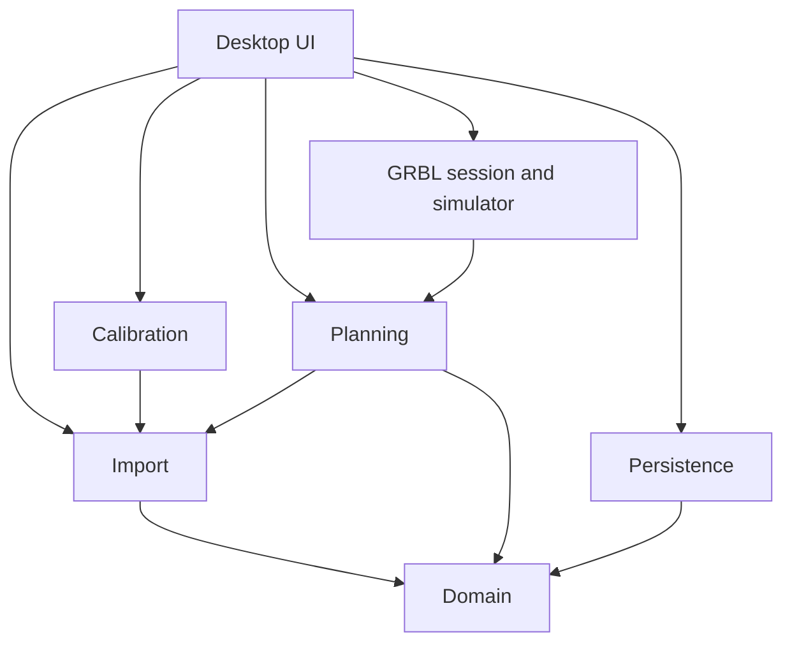

<p align="center">
  <picture>
    <source media="(prefers-color-scheme: dark)" srcset="docs/logo-dark.png">
    
  </picture>
</p>

<h3 align="center">An open, offline workspace for laser cutting and engraving.</h3>

LaserCat is a desktop application, written in Rust, for arranging artwork, setting cut and engrave operations, previewing toolpaths, and running jobs on **GRBL 1.1 controllers over USB**. It gives simple GRBL laser machines a visual, millimeter-based workflow in three steps: **Prepare → Preview → Device**.

The interface is inspired by [OrcaSlicer](https://github.com/OrcaSlicer/OrcaSlicer).

**English** · [Português (Brasil)](README.pt-BR.md) · Repository: [github.com/DevJHenrique/LaserCat](https://github.com/DevJHenrique/LaserCat)



> [!WARNING]
> **Early development (0.2.2).** Windows x64 is the only validated platform. Machine workflows are tested against a GRBL simulator; compatibility and physical results must be checked by the operator on their own equipment. Software controls never replace the machine's physical emergency stop, enclosure, and eye protection.

## Contents

- [Why LaserCat](#why-lasercat)
- [Features](#features)
- [Getting started](#getting-started)
- [Workflow](#workflow)
- [Project files](#project-files)
- [Architecture](#architecture)
- [Development](#development)
- [Contributing](#contributing)
- [Roadmap](#roadmap)
- [License](#license)

## Why LaserCat

- **Local and open.** No account, no cloud service, no telemetry. Projects are portable files you own.
- **Safety first.** Laser-off travel, bed-bounds checks, explicit work origin, worker-side interlocks, and a job is "done" only when the controller reports `Idle` after every command was acknowledged.
- **One plan for everything.** Preview, G-code export, and execution use the same immutable job plan, so what you see is what runs.
- **Hackable.** A small, layered Rust codebase whose core runs without a window or hardware, with a simulator, extensive tests, and documented architecture.

## Features

| Area | Capabilities |
| --- | --- |
| Workspace | Configurable machine dimensions, grid, rulers, zoom, pan, fit-to-bed |
| Artwork | Multiple SVG, PNG, and JPEG files; selection, overlap, locking, duplication, alignment |
| Transforms | Corner resize, rotation handle, scaling, mirroring, floating numeric editor |
| Operations | Vector cut, line engrave, fill engrave, raster engrave; power, speed, and passes per operation |
| Editing | Rectangles, circles, outlined text, undo, redo |
| Preview | Toolpaths, laser-off travel, warnings, time estimate, generated G-code |
| Device | COM port discovery, manual connection, jog, G54 work origin, laser-off framing, pause, resume, cancel |
| Calibration | Editable power × speed test matrices for engraving and cutting |
| Persistence | Portable `.lcc` projects with embedded assets, atomic saves, automatic recovery |

The interface is available in **English** (default) and **Português (Brasil)**: switch from the **Language** menu in the top bar. Translations are plain JSON files in [`locales/`](locales), so new languages are easy to contribute. See the [user guide](docs/USER_GUIDE.md) for details and limitations.

| Preview | Device | Calibration |
| --- | --- | --- |
|  |  |  |

## Getting started

**Requirements:** Windows x64, your controller's USB serial driver, and a GPU with OpenGL 3.3. The installer bootstrap needs .NET Framework 4.x; the portable executable does not.

### Try it without a machine

Install the [Rust toolchain](docs/DEVELOPMENT.md) (the version is pinned by `rust-toolchain.toml`), then:

```powershell
git clone https://github.com/DevJHenrique/LaserCat.git
cd LaserCat
cargo run --locked -- --demo
```

The demo opens a fictional 300 × 200 mm machine connected to the built-in simulator. Nothing is sent to real hardware.

### Use it with your machine

```powershell
cargo run --locked --release
```

On first start LaserCat asks for your machine's real usable area. Close LaserGRBL or any other program holding the same COM port first. Release packages (portable executable, installer, and matching source archive) are built locally with `scripts/Build-Package.ps1` into `dist/<version>/`.

## Workflow

1. **Prepare**: configure the machine, import artwork, arrange objects, and set operation parameters.
2. **Preview**: generate and inspect toolpaths, dimensions, overlaps, bounds, time, and G-code. Any edit invalidates the plan.
3. **Device**: choose the simulator or a USB port. In **user-origin mode**, connecting sets the current head position as G54 X0/Y0 with the laser off and without moving. Absolute-table mode requires homing first.
4. Run **Frame without laser** to check placement, then start the job. Editing is frozen while a job runs or is paused; **Stop and edit** cancels and invalidates the reference.

Progress counts commands acknowledged by GRBL. A job is complete only after all acknowledgements and a later `Idle` report. Calibration templates are included for [engraving](calibration/engraving-calibration.lcc) and [cutting](calibration/cutting-calibration.lcc).

## Project files

The native format is **`.lcc`**: a ZIP with a versioned JSON manifest and embedded assets. See the [format specification](docs/FILE_FORMAT.md) and [JSON Schema](docs/schemas/lcc-v1.schema.json).

- Legacy `.laser` v1 projects remain readable; saving writes `.lcc` and keeps the original file.
- SVG, PNG, and JPEG are inputs; G-code is an output. Neither holds the full editable project.
- Importing `.lbrn2`, `.3mf`, or G-code as editable scenes is not implemented.

The machine profile lives at `%LOCALAPPDATA%\LaserCat\device.json`, the interface language at `preferences.json`, and the recovery copy at `recovery.lcc` in the same folder. Connections, homing, and physical references are never restored from disk.

## Architecture

LaserCat is a **layered modular monolith**: one Cargo package with a library and a desktop binary. Domain, planning, persistence, and protocol code run without a window. The UI coordinates background work; one GRBL worker owns the serial transport.



| Module | Responsibility |
| --- | --- |
| `domain` | Projects, profiles, assets, transforms, operations |
| `limits` | Shared resource budgets for untrusted input |
| `i18n` | Interface language and translation lookup |
| `import` | SVG, font, and raster normalization |
| `calibration` | Reproducible calibration projects |
| `planner` | Job plan, ordering, bounds, estimates, G-code |
| `storage` | Project archives, compatibility, profiles, atomic writes |
| `grbl` | Session, state machine, transport, protocol, simulator |
| `ui` | Workspace, panels, actions, dialogs, presentation |

These boundaries are enforced by `tests/architecture.rs`. Read [ARCHITECTURE.md](ARCHITECTURE.md) for contracts and rules, and the [architecture decisions](docs/adr/README.md) for their rationale.

## Development

Install Rust through rustup, **Visual Studio MSVC Build Tools**, and the Windows SDK. Then:

```powershell
.\scripts\Test-Project.ps1
.\scripts\Test-Project.ps1 -Profile release
```

The script runs formatting, Clippy with warnings denied, every test target, and doctests; add `-Offline` once dependencies are cached. CI runs both profiles on Windows before packaging. See [development](docs/DEVELOPMENT.md) and [testing](docs/TESTING.md).

```text
src/            library and desktop binary (see ARCHITECTURE.md)
locales/        interface translations (English text -> translation)
assets/         application icon
tests/          integration, compatibility, protocol, i18n, and architecture tests
examples/       UI renderer, calibration generator, port tools
docs/           user guide, format spec, ADRs, testing, agent guide, screenshots
calibration/    ready-made calibration projects
scripts/        verification, packaging, notices
.claude/        shared AI-agent settings, review subagents, skills
```

## Contributing

Code, tests, documentation, translations, accessibility, and hardware reports are all welcome — **no laser is needed to contribute**.

1. Read [CONTRIBUTING.md](CONTRIBUTING.md) and the [code of conduct](CODE_OF_CONDUCT.md).
2. Pick or open an [issue](https://github.com/DevJHenrique/LaserCat/issues). *Scoped task* issues list the owning module and acceptance criteria.
3. Run `cargo run --locked -- --demo`, make a focused change in the owning module, and add a regression test.
4. Run the verification script and open a pull request using the template.

Where help is most useful right now:

- **Hardware reports:** results on specific GRBL 1.1 boards and machines (simulator vs. physical clearly separated).
- **Import robustness:** SVG edge cases from Inkscape, Illustrator, and other editors, with fixtures.
- **Translations:** new languages in [`locales/`](locales) and review of the existing Portuguese text.
- **UI:** keyboard navigation and accessibility.
- **Platforms:** building and serial access on Linux and macOS (not yet validated).

**AI-assisted contributions are welcome** when the author reviews, understands, and validates the result. [AGENTS.md](AGENTS.md) holds the shared rules for any coding agent, [CLAUDE.md](CLAUDE.md) imports them for Claude Code, and [docs/AI_AGENTS.md](docs/AI_AGENTS.md) explains the review subagents, skills, and risk-based review routing. Agents never operate physical hardware.

Report security issues as described in [SECURITY.md](SECURITY.md). Never commit credentials, machine profiles, or private projects.

## Roadmap

- Editing ergonomics, keyboard navigation, and accessibility.
- More SVG, raster, persistence, and protocol regression cases.
- Validation on more GRBL 1.1 controllers, with documented physical results.
- Machine profiles and calibration that keep local preferences separate from project data.
- Additional platforms once builds, serial access, and distribution are validated.

Camera integration, nesting, node editing, automatic vectorization, other controller protocols, and 3D slicing are out of scope for the current release.

## License

LaserCat is licensed under the **GNU Affero General Public License, version 3 only** (`AGPL-3.0-only`). See [LICENSE](LICENSE), [NOTICE](NOTICE), and the [licensing guide](docs/LICENSING.md). Commercial use is allowed under the license terms.

Earlier MIT grants remain valid for versions distributed under those terms; their notice is kept in [LICENSES/MIT-legacy.txt](LICENSES/MIT-legacy.txt). Third-party dependencies keep their own licenses; see [CREDITS.md](CREDITS.md).
