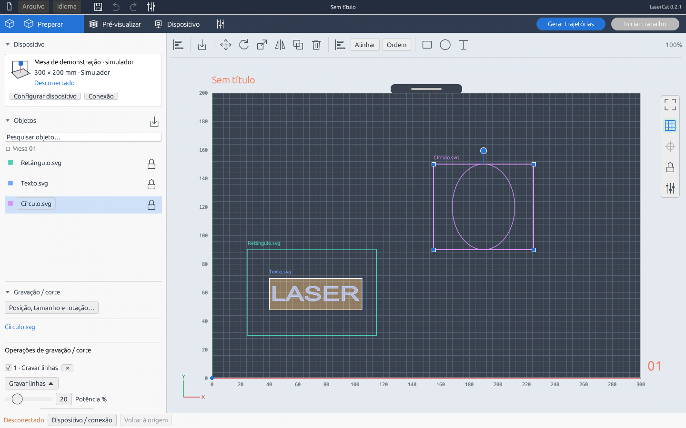

<p align="center">
  <picture>
    <source media="(prefers-color-scheme: dark)" srcset="docs/logo-dark.png">
    
  </picture>
</p>

<h3 align="center">Um espaço de trabalho aberto e offline para corte e gravação a laser.</h3>

O LaserCat é um aplicativo desktop em Rust para organizar artes, configurar operações de corte e gravação, pré-visualizar trajetórias e executar trabalhos em **controladoras GRBL 1.1 via USB**. Ele traz um fluxo visual, em milímetros, para máquinas laser GRBL simples, em três etapas: **Preparar → Pré-visualizar → Dispositivo**.

A interface é inspirada no [OrcaSlicer](https://github.com/OrcaSlicer/OrcaSlicer).

[English](README.md) · **Português (Brasil)** · Repositório: [github.com/DevJHenrique/LaserCat](https://github.com/DevJHenrique/LaserCat)

Esta é uma tradução do README. A documentação de referência (arquitetura, contribuição, especificações) é mantida em inglês.



A interface está disponível em **inglês** (padrão) e **português do Brasil**: troque pelo menu **Language / Idioma** na barra superior. A escolha fica salva neste computador.

> [!WARNING]
> **Desenvolvimento inicial (0.2.2).** Windows x64 é a única plataforma validada. Os fluxos de máquina são testados com um simulador GRBL; compatibilidade e resultados físicos devem ser conferidos pelo operador no próprio equipamento. Controles de software nunca substituem a parada de emergência física, o enclausuramento e a proteção ocular.

## Por que o LaserCat

- **Local e aberto.** Sem conta, sem nuvem, sem telemetria. Os projetos são arquivos portáteis seus.
- **Segurança em primeiro lugar.** Deslocamentos com laser desligado, verificação dos limites da mesa, origem de trabalho explícita, travas no worker e um trabalho só é "concluído" quando a controladora informa `Idle` depois de confirmar todos os comandos.
- **Um único plano.** Prévia, exportação de G-code e execução usam o mesmo plano imutável: o que você vê é o que roda.
- **Fácil de estudar e modificar.** Código Rust em camadas, cujo núcleo roda sem janela nem hardware, com simulador, muitos testes e arquitetura documentada.

## Recursos

| Área | Recursos |
| --- | --- |
| Área de trabalho | Dimensões da máquina, grade, réguas, zoom, deslocamento, ajustar à mesa |
| Artes | Vários arquivos SVG, PNG e JPEG; seleção, sobreposição, bloqueio, duplicação, alinhamento |
| Transformações | Redimensionar pelos cantos, alça de rotação, escala, espelhamento, editor numérico |
| Operações | Corte vetorial, gravação de linhas, gravação de área e gravação de imagem; potência, velocidade e passadas por operação |
| Edição | Retângulos, círculos, texto em contornos, desfazer, refazer |
| Prévia | Trajetórias, deslocamentos sem laser, avisos, tempo estimado, G-code gerado |
| Dispositivo | Descoberta de portas COM, conexão manual, jog, origem G54, contorno sem laser, pausar, retomar, cancelar |
| Calibração | Matrizes editáveis de potência × velocidade para gravação e corte |
| Persistência | Projetos `.lcc` portáteis com recursos embutidos, gravação atômica e recuperação automática |

## Primeiros passos

**Requisitos:** Windows x64, driver serial USB da controladora e GPU com OpenGL 3.3.

Para testar sem máquina, instale o [Rust](docs/DEVELOPMENT.md) (a versão é fixada em `rust-toolchain.toml`) e rode:

```powershell
git clone https://github.com/DevJHenrique/LaserCat.git
cd LaserCat
cargo run --locked -- --demo
```

A demonstração abre uma máquina fictícia de 300 × 200 mm ligada ao simulador; nada é enviado a hardware real. Para usar com sua máquina:

```powershell
cargo run --locked --release
```

Feche o LaserGRBL ou qualquer programa que esteja usando a mesma porta COM antes de conectar.

## Contribuindo

Código, testes, documentação, traduções, acessibilidade e relatos de hardware são bem-vindos — **não é preciso ter um laser para contribuir**. Issues, pull requests e código usam inglês por padrão, mas perguntas em português são bem-vindas. As traduções da interface ficam em [`locales/`](locales) (por exemplo, `locales/pt-BR.json`): basta editar o texto em português correspondente a cada frase em inglês.

1. Leia o [CONTRIBUTING.md](CONTRIBUTING.md) e o [código de conduta](CODE_OF_CONDUCT.md).
2. Escolha ou abra uma issue. Issues do tipo *Scoped task* indicam o módulo responsável e os critérios de aceite.
3. Rode a demonstração, faça uma mudança focada no módulo responsável e adicione um teste de regressão.
4. Rode `.\scripts\Test-Project.ps1` e abra o pull request usando o modelo.

**Contribuições com auxílio de IA são bem-vindas** quando o autor revisa, entende e valida o resultado. O [AGENTS.md](AGENTS.md) contém as regras compartilhadas para qualquer agente; o [docs/AI_AGENTS.md](docs/AI_AGENTS.md) explica os subagentes de revisão, as skills e o roteamento de revisão por risco. Agentes nunca operam hardware físico.

## Licença

O LaserCat é licenciado sob a **GNU Affero General Public License, versão 3 apenas** (`AGPL-3.0-only`). Veja [LICENSE](LICENSE), [NOTICE](NOTICE) e o [guia de licenciamento](docs/LICENSING.md). O uso comercial é permitido nos termos da licença. Detalhes de arquitetura, formato de arquivo e desenvolvimento estão no [README em inglês](README.md).
